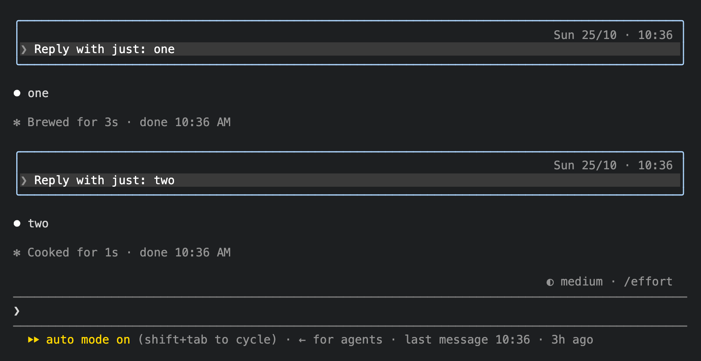

<div align="center">

# claude-code-tweaks

**Small tweaks to the Claude Code terminal, each one switched on or off in `/config`.**

[](LICENSE)
[](https://github.com/anthropics/claude-code)

[Quick Start](#quick-start) &#183; [The tweaks](#the-tweaks) &#183; [Configuration](#configuration) &#183; [How it works](#how-it-works)



</div>

---

With a dozen Claude Code sessions open in tabs, none of them says when you last wrote in it, and your own messages are hard to pick out between Claude's replies. This plugin adds what is missing, one tweak at a time, in the spirit of the old TweakUI: each tweak is a switch in `/config`, and a tweak switched off leaves Claude Code drawing exactly as it does without the plugin.

## Quick Start

At the prompt of a Claude Code session in a terminal:

```
/plugin install tweaks --marketplace Bloomidea/claude-code-tweaks
```

Answer `y` to add the marketplace, then pick a scope (user, so every session has it). The plugin is active in that session at once.

From a shell:

```bash
claude plugin install tweaks --marketplace Bloomidea/claude-code-tweaks
```

## The tweaks

| Tweak | What you see | On by default |
|---|---|---|
| **Time on your messages** | `Sun 25/10 · 10:29` on the right of each of your messages, also in a session resumed with `/resume` | yes |
| **Frame around your messages** | A frame in a color of your theme around each of your messages | yes |
| **Last message line** | `last message 10:29 · 2h ago` at the end of the hint line under the prompt | yes |

Only your own messages, typed here or sent from the phone or the web, get a time and a frame. Background task notifications and messages from other sessions or agents are drawn as before. The tweaks change the drawing alone: the transcript and what Claude reads stay as they were.

## Configuration

Run `/config` and look for the `tweaks` rows. A change applies at once.

| Setting | Values | Default |
|---|---|---|
| Time on your messages | on, off | on |
| Date format | `Sun 25/10`, `25/10`, `Sun 10/25`, `10/25`, `2026-10-25` | `Sun 25/10` |
| Date on today's messages | on, off (off shows the time alone on today's messages) | on |
| Clock | `24h`, `12h` | `24h` |
| Frame around your messages | on, off | on |
| Frame style | `round`, `single`, `bold`, `double`, `dashed`, `quote` (a bar on the left) | `round` |
| Frame color | `suggestion`, `permission`, `claude`, `promptBorder`, `subtle`, `success`, `warning`, `planMode`, `autoAccept`, `ide` | `suggestion` |
| Last message line | on, off | on |

The frame colors are names from your Claude Code theme, so the frame follows `/theme` in light and dark.

## How it works

The time of a message is the `timestamp` Claude Code records for it in the session's transcript (`~/.claude/projects/<project>/<session>.jsonl`, or under `CLAUDE_CONFIG_DIR`). The plugin reads the prompt rows of that file when a message it has no time for is drawn, so a live session and a resumed one show the same time. A transcript larger than 4 MiB is filtered with `grep` first. A message you send while Claude is working is recorded when Claude takes it in, and shows that time.

The plugin is a hooks module of Claude Code's plugin API (`ui.render` on `UserMessage` and `PromptHint`). It reads files and runs `grep`; it writes nothing and sends nothing over the network.

## Requirements

- Claude Code 2.1.310 or later, in a terminal. The plugin API is in early access and may change between releases; the version each release was tested with is in the [CHANGELOG](CHANGELOG.md).
- In the desktop app, VS Code and the mobile app the plugin draws nothing of its own.
- `grep` on the `PATH` for transcripts above 4 MiB (macOS and Linux have it). Without it, messages of such a session resumed with `/resume` show no time.

## Adding a tweak

Each tweak is a module in `hooks/` registered from `hooks/register.tsx` only while its switch is on, with its fields in `userConfig` in `.claude-plugin/plugin.json`, tests in `tests/`, a section here and a line in the CHANGELOG.

```bash
claude plugin validate .
claude plugin test .
claude --plugin-dir .   # a session with the plugin loaded from this folder
```

## License

[MIT](LICENSE)
