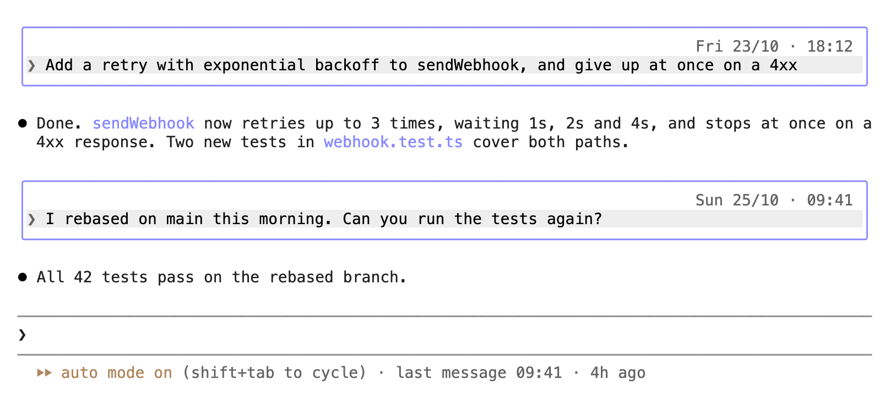

<div align="center">

# claude-code-tweaks

**Small tweaks to the Claude Code terminal, each one a switch in `/config`.**

[](https://github.com/Bloomidea/claude-code-tweaks/actions/workflows/test.yml)
[](LICENSE)
[](https://github.com/anthropics/claude-code)

[Quick Start](#quick-start) &#183; [The tweaks](#the-tweaks) &#183; [Configuration](#configuration) &#183; [How it works](#how-it-works) &#183; [FAQ](#faq)

<picture>
  <source media="(prefers-color-scheme: dark)" srcset="assets/screenshot-dark.png">
  
</picture>

</div>

---

Keep a few Claude Code sessions open in tabs and come back to one after lunch: nothing on screen says when you wrote what, or how long the session has been sitting there, and your own messages blend into Claude's replies. Claude Code has open requests for both, [timestamps on messages](https://github.com/anthropics/claude-code/issues/44763) and [a visual distinction for your messages](https://github.com/anthropics/claude-code/issues/98316).

This plugin adds them as tweaks you can switch on and off. A tweak switched off leaves Claude Code drawing exactly as it does without the plugin, and none of them changes what Claude reads.

## Quick Start

At the prompt of a Claude Code session in a terminal:

```
/plugin install tweaks --marketplace Bloomidea/claude-code-tweaks
```

Answer `y` to add the marketplace and pick the user scope, so every session has it. The plugin is active in that session at once.

From a shell:

```bash
claude plugin install tweaks --marketplace Bloomidea/claude-code-tweaks
```

## The tweaks

All three are on by default.

### Time on your messages

The date and time each of your messages was sent, `Fri 23/10 · 18:12`, on the right above the message, in the blank row Claude Code already leaves there. The time comes from the session's transcript, so a session you pick up again with `/resume` shows the same times it showed live.

### Frame around your messages

A frame around each of your messages, in a color of your Claude Code theme, so you find your own words in a long scrollback at a glance, in the light theme and the dark.

### Last message line

`last message 09:41 · 4h ago` at the end of the hint line under the prompt, counting on every minute. Going through your tabs, you see which session you left an hour ago and which one you left yesterday.

Only your own messages, typed in the terminal or sent through Remote Control, get a time and a frame. Background task notifications and messages from other sessions or agents are drawn as before.

## Configuration

Run `/config` and type `tweaks` to see its rows. A change applies at once.

| Setting | Values | Default |
|---|---|---|
| Time on your messages | on, off | on |
| Date format | `Sun 25/10`, `25/10`, `Sun 10/25`, `10/25`, `2026-10-25` | `Sun 25/10` |
| Date on today's messages | on, off (off leaves the time alone on today's messages) | on |
| Clock | `24h` (14:05), `12h` (2:05 pm) | `24h` |
| Frame around your messages | on, off | on |
| Frame style | `round`, `single`, `bold`, `double`, `dashed`, `quote` (a bar on the left) | `round` |
| Frame color | `suggestion`, `permission`, `claude`, `promptBorder`, `subtle`, `success`, `warning`, `planMode`, `autoAccept`, `ide` | `suggestion` |
| Last message line | on, off | on |

The frame colors are names from your Claude Code theme, so the frame follows `/theme`.

## How it works

Claude Code records every message in the session's transcript, `~/.claude/projects/<project>/<session>.jsonl` (under `CLAUDE_CONFIG_DIR` when you set it), with the time it was recorded. When a message of yours is drawn and the plugin does not know its time yet, it reads the prompt rows of that file. A new message shows the time it is drawn straight away, and the transcript's time a moment later; the two are milliseconds apart. A transcript larger than 4 MiB goes through `grep` first, so a large file is never read whole.

The tweaks are hooks of Claude Code's plugin API on two of the things the terminal draws: each message of yours (`UserMessage`) and the hint line under the prompt (`PromptHint`). The plugin reads files and runs `grep`. It writes no file and makes no network request.

## Requirements

- Claude Code 2.1.310 or later, in a terminal. The plugin API it uses is in early access and can change between releases; the [CHANGELOG](CHANGELOG.md) says which version each release was tested with.
- macOS or Linux. The plugin is developed and used on macOS, and its tests run on Linux in CI. Windows is untested.
- `grep` on the `PATH`, for transcripts above 4 MiB. Without it, a resumed session with a transcript that large shows no times.

In the desktop app, the VS Code extension and the mobile app the plugin draws nothing of its own, and Claude Code draws as usual.

## FAQ

**A message shows no time.** The plugin found no transcript for the session. It looks for the session's file under the folder of the directory the session runs in, then under every project folder in `~/.claude/projects`.

**A message I sent while Claude was working shows a later time than when I pressed Enter.** Claude Code records a queued message when it takes it in, and the plugin shows the recorded time, so a live session and a resumed one always agree.

**Does it change what Claude reads?** No. It changes how the terminal draws your messages and the hint line; the transcript and the conversation Claude sees stay as they were.

**How do I switch it off?** Each tweak has its switch in `/config`. To switch the whole plugin off, `claude plugin disable tweaks@claude-code-tweaks`; to remove it, `claude plugin uninstall tweaks@claude-code-tweaks`.

## Contributing

Ideas and bug reports are welcome as [issues](https://github.com/Bloomidea/claude-code-tweaks/issues). New tweaks come from popular requests on [anthropics/claude-code](https://github.com/anthropics/claude-code/issues) that a plugin can answer without changing Claude Code; when Claude Code gains one of them natively, its tweak turns off by default.

Each tweak is a module in `hooks/`, registered from `hooks/register.tsx` only while its switch is on, with its fields under `userConfig` in `.claude-plugin/plugin.json`, its tests in `tests/`, a section in this README and a line in the [CHANGELOG](CHANGELOG.md).

```bash
claude plugin validate .
claude plugin test .
claude --plugin-dir .   # a session with the plugin loaded from this folder
```

## License

[MIT](LICENSE), by [Bloomidea](https://bloomidea.com).
